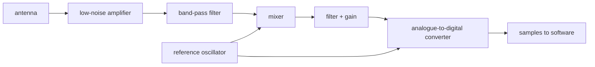

# From antenna to samples

> **Who this is for:** You are comfortable with software and digital signals but have never worked with radio hardware. You want to know what happens between the antenna and the first number the receiver's software sees.

> **You will learn:**
> - What a radio front-end does and why it is the same for every GNSS receiver
> - Enough about decibels, mixing, and sampling to read a front-end data sheet
> - Why one or two bits per sample is enough
> - Why the reference oscillator is the most important part on the board

This page is conceptual. The series continues with [finding a satellite](04-acquisition.md).

---

## The job

A GNSS signal arrives at the antenna as a 1.5 GHz wave with about 10^-16 watts of power, buried in noise. Software cannot work with that. The front-end turns it into a stream of small integers at a few million samples per second, with the signal still buried in noise but now at a frequency a computer can handle. Every GNSS receiver, from a phone to a survey instrument to this project, has the same chain:

In this project the stages from the amplifier to the converter live in one chip, a MAX2771, one per antenna and band. The antenna and the reference oscillator sit outside it, and they are the two parts that decide how good the receiver can be.

## Decibels in one paragraph

Radio people measure everything in decibels because the numbers span twenty orders of magnitude. A decibel is a ratio on a log scale: 10 dB is 10 times the power, 20 dB is 100 times, 30 dB is 1000 times, and 3 dB is roughly double. Negative values are losses. A "dBm" is a power relative to one milliwatt, so -130 dBm is 10^-13 milliwatts. "dB-Hz" is the C/N0 ratio from the previous page. When a data sheet says an amplifier has 20 dB of gain and a noise figure of 1 dB, it means it makes the signal 100 times stronger and adds 26 percent to the noise while doing so.

## The antenna

A GNSS antenna is tuned to the band and is circularly polarised. GNSS satellites transmit with right-hand circular polarisation, so the antenna is designed to favour it. A reflection changes the polarisation: off the ground at steep angles it largely reverses to left-hand, which the antenna rejects, but at shallow angles and off many materials it comes back as a mix the antenna still partly hears. How much a reflection is suppressed depends on the surface, the arrival direction and the antenna, so there is no fixed figure. Survey antennas add a ground plane or a choke ring to suppress multipath, especially signals arriving from below the horizon.

Almost every GNSS antenna is active: it has its own amplifier inside, powered through the same coaxial cable that carries the signal, with a few volts of DC placed on the cable by the receiver. That first amplifier sets the noise performance of the whole chain, because everything after it amplifies both the signal and the noise it adds. This is the low-noise amplifier, and "low noise" is the whole point.

Where the signal is received is the antenna's phase centre, a point near the element that moves slightly with frequency and direction. For a metre-level fix it does not matter. For RTK it does, and survey antennas ship with calibration tables for it.

## Filtering and mixing

The filter after the amplifier passes only the GNSS band, a few MHz to a few tens of MHz wide, and rejects everything else, in particular mobile phone signals a few hundred MHz away that are billions of times stronger.

The mixer is the part that puzzles people without a radio background. Multiplying the incoming signal by a locally generated sine wave at a nearby frequency produces copies of the signal at the sum and the difference of the two frequencies. The difference is what is kept. Mixing 1575.42 MHz with a local oscillator at 1571.42 MHz gives a copy of the entire GPS L1 signal centred at 4 MHz, unchanged in every other way. That copy is at the intermediate frequency, the IF, and from here on everything happens at a few MHz instead of 1.5 GHz. If the local oscillator is set to the band centre, the IF is zero and the signal lands at baseband.

Mixing with two local oscillator copies 90 degrees apart gives two outputs, called I and Q (in-phase and quadrature). Together they form a complex sample that keeps the sign of the frequency offset, which a single real output loses. Receivers use either: real sampling at a non-zero IF, or I/Q sampling at or near zero IF. The software has to know which it was given.

## Sampling

The analogue-to-digital converter samples the filtered IF signal millions of times a second. With real samples, the rate has to be more than twice the highest frequency left after the filter: the 2 MHz main lobe of GPS L1 C/A centred at a 4 MHz IF reaches 5 MHz, so it needs more than 10 million samples per second. With I/Q sampling at zero IF the same band runs from -1 to +1 MHz, and a little over 2 million complex samples per second, each an I and a Q value, is enough. L5 and Galileo E5a, whose codes are ten times faster, have main lobes about 20 MHz wide and need a little over 20 million complex samples per second, or a correspondingly higher real rate. A carefully chosen pairing of IF and sample rate (band-pass sampling) can go lower, and real filters need some margin on top.

The surprising part is the resolution. One or two bits per sample is enough, and some receivers use one. The signal is 20 dB below the noise, so each sample is almost entirely noise and the signal is only a slight bias in the sign. A 1-bit converter loses about 2 dB of sensitivity relative to a perfect one, and 2 bits lose about half a decibel. Front-end chips use automatic gain control to keep the noise amplitude at the right level for the few quantiser thresholds they have, which is why a GNSS front-end does not have a gain setting in the usual sense.

A recording of two bits per sample at 20 million samples per second is 5 MB per second, and this is the raw material every later page works on. The recordings `pyrx` was developed on are exactly this: a file of 8-bit integers, each holding one sample, with a known sample rate and IF.

## The reference oscillator

One crystal oscillator on the board generates the local oscillator for the mixer and the sampling clock for the converter. Everything the receiver measures is measured against it. If it runs 1 part per million fast, every satellite appears to have an extra 1.5 kHz of Doppler shift, the sample clock counts time 1 microsecond per second wrong, and the receiver's clock bias drifts at 300 m per second until the position solver absorbs it.

The solver does absorb it. The receiver clock error is one of the four unknowns in every fix, so a cheap oscillator does not prevent a correct position. What it does affect is how far the receiver can integrate before the oscillator's short-term jitter blurs the carrier phase, and therefore how weak a signal it can track and how clean its carrier-phase measurements are. For RTK the oscillator's phase noise, its wobble over tens of milliseconds, matters more than its absolute accuracy. This is why a temperature-compensated crystal oscillator is chosen for its phase-noise specification rather than its frequency tolerance.

For a receiver with several antennas, the other requirement is that every front-end shares the same oscillator and sample clock. Only then can the phase difference between two antennas be measured, which is what makes a multi-antenna receiver more than several receivers in one box.

---

**In pyrx:** `samples.py` reads recordings in the sample formats described above (real or I/Q, with the sample rate and IF given on the command line). There is no front-end in software; the recordings come from a Pocket SDR front-end or from this project's hardware when it exists.

Next: [Finding a satellite](04-acquisition.md).
