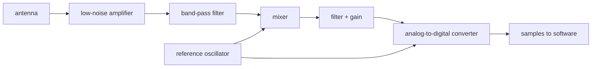

# From antenna to samples

> **Who this is for:** You are comfortable with software and digital signals but have never worked with radio hardware. You want to know what happens between the antenna and the first number the receiver's software sees.

> **You will learn:**
> - What a radio front-end does and why it is the same for every GNSS receiver
> - Enough about decibels, noise figure, mixing, and sampling to read a front-end data sheet
> - Why one or two bits per sample is enough
> - Why the reference oscillator is the most important part on the board

This page is conceptual. The series continues with [finding a satellite](04-acquisition.md).

---

## The job

A GNSS signal arrives at the antenna as a 1.5 GHz wave with about 10^-16 watts of power, buried in noise. Software cannot work with that. The front-end turns it into a stream of small integers at a few million samples per second, with the signal still buried in noise but now at a frequency a computer can handle. Every GNSS receiver, from a phone to a survey instrument to this project, has the same chain:

In this project most of the chain lives in one chip, a MAX2771, one per antenna and band: an amplifier, the mixer, the frequency synthesizer, the IF filter with its gain control, and the converter. The first low-noise amplifier sits in the active antenna, and the chip brings its own amplifier's output and its mixer's input out on separate pins, so any RF band-pass filter between them is an external part. The antenna and the reference oscillator also sit outside the chip, and they are the two parts that decide how good the receiver can be.

## Decibels in one paragraph

Radio people measure everything in decibels because the numbers span twenty orders of magnitude. A decibel is a ratio on a log scale: a power $P$ against a reference $P_0$ is $10\log_{10}(P/P_0)$ dB, so 10 dB is 10 times the power, 20 dB is 100 times, 30 dB is 1000 times, and 3 dB is roughly double. Negative values are losses. A "dBm" is a power relative to one milliwatt, so -130 dBm is 10^-13 milliwatts. "dB-Hz" is the C/N0 ratio from the previous page. When a data sheet says an amplifier has 20 dB of gain and a noise figure of 1 dB, it means it makes the signal 100 times stronger and adds 26 percent to the noise while doing so.

The noise floor itself is easy to compute. A resistor delivers thermal noise of $kT$ watts in every hertz of bandwidth, with $k$ Boltzmann's constant and $T$ the temperature in kelvin. At the 290 K reference temperature, roughly room temperature, that is -174 dBm per hertz. An antenna delivers about the same; one looking mostly at the cold sky delivers somewhat less. Over the 2 MHz of the GPS L1 C/A signal, add $10\log_{10}(2 \times 10^6) \approx 63$ dB to get -111 dBm. The weakest L1 C/A signal the GPS specification allows at the ground is -128.5 dBm, 17.5 dB below that floor, which is where the "roughly 20 dB below the noise" of the previous page comes from.

## The antenna

A GNSS antenna is tuned to the band and is circularly polarized. GNSS satellites transmit with right-hand circular polarization (RHCP), so the antenna is designed to favor it. A reflection changes the polarization: off the ground at steep angles it largely reverses to left-hand (LHCP), which the antenna rejects, but at shallow angles and off many materials it comes back as a mix the antenna still partly hears. How much a reflection is suppressed depends on the surface, the arrival direction and the antenna, so there is no fixed figure. Survey antennas add a ground plane or a choke ring to suppress multipath, especially signals arriving from below the horizon.

Almost every GNSS antenna is active: it has its own amplifier inside, powered through the same coaxial cable that carries the signal, with a few volts of DC placed on the cable by the receiver. That first amplifier is the low-noise amplifier, LNA, and it sets the noise performance of the whole chain, because everything after it amplifies both the signal and the noise it adds.

The rule behind that is the Friis formula for a chain of stages. Write each stage's noise figure as a plain ratio $F$ (1 dB is $F = 1.26$) and its gain as a ratio $G$. For a first stage followed by a second, the noise figure of the pair is

$$
F_{\rm total} = F_1 + \frac{F_2 - 1}{G_1} .
$$

The second stage's noise is divided by the first stage's gain. With a 1 dB, 20 dB-gain LNA ($F_1 = 1.26$, $G_1 = 100$) feeding a cable and receiver with a 10 dB noise figure ($F_2 = 10$), the total is $1.26 + 9/100 = 1.35$, or 1.3 dB. Without the LNA the chain would start at 10 dB. That is why "low noise" is the whole point of the first amplifier and why it sits at the antenna, before the cable's loss.

Where the signal is received is the antenna's phase center, a point near the element that moves slightly with frequency and direction. For a meter-level fix it does not matter. For RTK it does, and survey antennas ship with calibration tables for it.

## Filtering and mixing

The filter after the amplifier is a band-pass filter: it passes only the GNSS band, a few MHz to a few tens of MHz wide, and rejects everything else, in particular mobile phone signals a few hundred MHz away that are billions of times stronger.

The mixer is the part that puzzles people without a radio background. It performs downconversion: it multiplies the incoming signal by a locally generated sine wave at a nearby frequency, the local oscillator, and the product contains copies of the signal at the sum and the difference of the two frequencies. The reason is a trigonometric identity, with $f_1$ the signal frequency and $f_2$ the local oscillator's:

$$
\cos(2\pi f_1 t) \cos(2\pi f_2 t) = \tfrac{1}{2} \cos(2\pi (f_1 - f_2) t) + \tfrac{1}{2} \cos(2\pi (f_1 + f_2) t) .
$$

A filter keeps the difference and removes the sum. Mixing 1575.42 MHz with a local oscillator at 1571.42 MHz gives a copy of the entire GPS L1 signal centered at 4 MHz, unchanged in every other way: the code, the data and the carrier's phase and Doppler all carry over. That copy is at the intermediate frequency, the IF, and from here on everything happens at a few MHz instead of 1.5 GHz. If the local oscillator is set to the band center, the IF is zero and the signal lands at baseband.

Mixing with two local oscillator copies 90 degrees apart, a cosine and a sine, gives two outputs, called I and Q (in-phase and quadrature). Together they form a complex sample $I + jQ$ that keeps the sign of the frequency offset. A single real output loses it, because a real cosine at +100 kHz is identical to one at -100 kHz. Receivers use either: real sampling at a non-zero IF, or I/Q sampling at or near zero IF. The software has to know which it was given.

## Sampling

The analog-to-digital converter samples the filtered IF signal millions of times a second. The rule it has to obey is the Nyquist criterion: the sample rate must be more than twice the highest frequency present, or frequencies above half the sample rate fold back onto lower ones and become indistinguishable from them, which is called aliasing. With real samples, the rate has to be more than twice the highest frequency left after the filter: the 2 MHz main lobe of GPS L1 C/A centered at a 4 MHz IF reaches 5 MHz, so it needs more than 10 million samples per second. With I/Q sampling at zero IF the same band runs from -1 to +1 MHz, and a little over 2 million complex samples per second, each an I and a Q value, is enough. L5 and Galileo E5a, whose codes are ten times faster, have main lobes about 20 MHz wide and need a little over 20 million complex samples per second, or a correspondingly higher real rate. A carefully chosen pairing of IF and sample rate (band-pass sampling, which uses aliasing on purpose to fold the band down) can go lower, and real filters need some margin on top.

The recording the pyrx notebooks use is a real one: 24 million samples per second at a 6 MHz IF. Half the sample rate is 12 MHz, comfortably above the main lobe's upper edge at about 7 MHz.

The surprising part is the resolution. One or two bits per sample is enough, and some receivers use one. The signal is 20 dB below the noise, so each sample is almost entirely noise and the signal is only a slight bias in the sign. Rounding each sample to so few levels is called quantization, and the error it adds behaves like a little extra noise. A 1-bit converter loses about 2 dB of sensitivity relative to a perfect one, and 2 bits lose about half a decibel. The 24 MHz recording is 2-bit: its samples, though stored one per byte, take only the four values -3, -1, +1 and +3. Front-end chips use automatic gain control (AGC), a loop that adjusts the gain continuously to keep the noise amplitude at the right level for the few quantizer thresholds they have, which is why a GNSS front-end does not have a gain setting in the usual sense.

If two-bit real samples are packed four to a byte, 20 million samples per second use 5 MB per second. Converter resolution and file storage are separate choices: the Pocket SDR recordings used by `pyrx` store each real value in a signed 8-bit integer. A real recording uses one byte per sample; an I/Q recording interleaves an I byte and a Q byte for each complex sample. At 20 million samples per second those formats use 20 MB/s and 40 MB/s respectively. `pyrx` reads these byte formats, so packed one- or two-bit data must be unpacked first.

## The reference oscillator

One crystal oscillator on the board is the reference for both the local oscillator of the mixer, which a frequency synthesizer in the front-end chip derives from it, and the sampling clock for the converter. Everything the receiver measures is measured against it. If it runs 1 part per million fast, every satellite's Doppler appears shifted by about 1.6 kHz (one millionth of 1575.42 MHz; lower when the oscillator runs fast), the sample clock counts time 1 microsecond per second wrong, and the receiver's clock bias drifts at 300 m per second until the position solver absorbs it.

The solver does absorb it. The receiver clock error is one of the four unknowns in every fix, so a cheap oscillator does not prevent a correct position. What it does affect is how long the receiver can integrate before the oscillator's short-term jitter blurs the carrier phase, and therefore how weak a signal it can track and how clean its carrier-phase measurements are. That short-term jitter is the oscillator's phase noise, its wobble over tens of milliseconds. For RTK the phase noise matters more than the absolute accuracy, so a temperature-compensated crystal oscillator (TCXO) is chosen for its phase-noise specification rather than its frequency tolerance.

For a receiver with several antennas, the other requirement is that every front-end shares the same oscillator and sample clock. Only then can the phase difference between two antennas be measured, which is what makes a multi-antenna receiver more than several receivers in one box.

---

**In pyrx:** `samples.py` reads signed 8-bit real recordings, or interleaved signed 8-bit I and Q values with `--iq`; the sample rate and IF are given by `--fs` and `--f-if`. Its tests write small files of known bytes and check the samples read back, including the start offset, the duration and the sign of Q, which follows the Pocket SDR front-end's I - jQ convention. There is no front-end in software; the recordings come from a Pocket SDR front-end or from this project's hardware when it exists.

Next: [Finding a satellite](04-acquisition.md).
